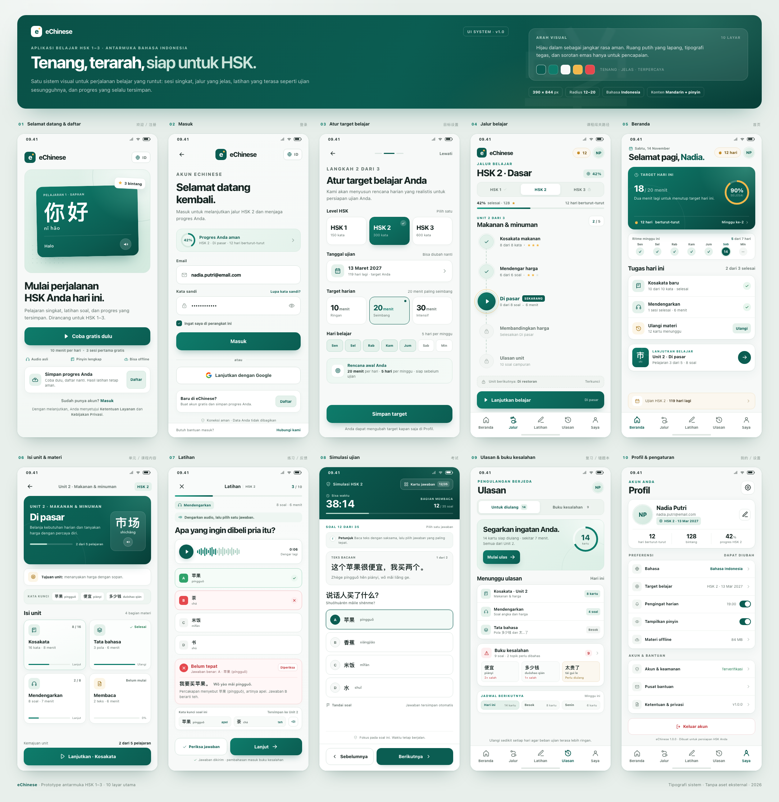

# eChinese · 视觉与界面设计规范

> 面向印度尼西亚 HSK 1–3 考生的中文学习 App  
> 版本：v1.0 · 2026.11 · 界面语言：Bahasa Indonesia · 学习内容：中文 + 拼音  
> 画板：390 × 844 px · 10 个核心界面



---

## 1. 设计定位

**一句话方向：Tenang, terarah, siap ujian.**  
安静、有方向感、为考试做准备。

eChinese 的用户不是为了“玩一个语言游戏”，而是要在有限时间内把 HSK 1–3 学完、练熟、考过。界面因此强调：

1. **可信**：深绿、留白、克制的金色点缀；没有吉祥物、没有大面积插画、没有庆祝彩带。
2. **清楚**：每屏只有一个主动作；路径、进度、下一步始终可见。
3. **可执行**：所有目标都能落到“今天做几分钟、做什么题、下一步点哪里”。
4. **有温度**：鼓励过程，不承诺结果；用温和的印尼语老师语气，而不是销售话术。
5. **为印尼市场而设计**：印尼语界面、中文学习内容带拼音、文本按中文源文案约 **1.7 倍**宽预留、避免截断。

视觉关键词：**Tenang · Jelas · Terpercaya**（安静、清晰、可信）。

---

## 2. 信息架构与 10 个交付界面

| # | 界面（印尼语） | 中文对应 | 主要任务 |
|---|---|---|---|
| 01 | Selamat datang & daftar | 欢迎 / 注册 | 先试学；用「Simpan progres Anda」承接注册 |
| 02 | Masuk | 登录 | 邮箱密码登录；找回密码；继续已保存进度 |
| 03 | Atur target belajar | 目标设置 | HSK 等级、考试日期、每日 10/20/30 分钟 |
| 04 | Jalur belajar | 课程闯关路径 | 等级 → 单元 → 关卡节点；完成/当前/锁定 |
| 05 | Beranda | 首页 | 今日任务、连续天数、继续学习、考试倒计时 |
| 06 | Isi unit & materi | 单元 / 课程内容 | 词汇、语法、听力、阅读入口 |
| 07 | Latihan | 练习 | 题干、作答、Periksa jawaban、对错反馈 |
| 08 | Simulasi ujian | 考试 | 计时、答题卡入口、上一题/下一题 |
| 09 | Ulasan & buku kesalahan | 复习 | 待复习队列、错题本、复习排期 |
| 10 | Profil & pengaturan | 我的 / 设置 | 语言、目标、提醒、退出登录 |

底部导航固定 5 项：**Beranda · Jalur · Latihan · Ulasan · Saya**。  
练习、考试、单元详情、目标设置、登录和欢迎页不显示底部导航，避免在任务中分散注意力。

---

## 3. 色彩系统

### 3.1 品牌色与语义色

| Token | HEX | 用途 | 白底对比度 |
|---|---|---|---|
| `--brand` | `#0B5D52` | 主品牌、主按钮、当前节点、深色 Hero | 7.77:1 |
| `--brand-2` | `#0E7C6B` | 渐变第二色、次级强调、焦点环 | 5.10:1 |
| `--brand-deep` | `#08443C` | 深色 Hero / 考试头部的收尾色 | 9.5:1 左右 |
| `--bg` | `#F7F9F8` | App 背景 | 1.06:1（仅背景） |
| `--card` | `#FFFFFF` | 卡片、输入框、底部导航 | — |
| `--ink` | `#152421` | 正文、标题、主要数字 | 16.08:1 |
| `--muted` | `#7C8A84` | 仅装饰、禁用、辅助图标 | 3.60:1 |
| `--muted-strong` | `#5F6F69` | 可读的次要正文（替代 `--muted`） | 5.30:1 |
| `--line` | `#E3EAE6` | 卡片描边、分隔线 | — |
| `--mint-50` | `#EEF7F2` | 浅色信息底 | — |
| `--mint-100` | `#E4F1EB` | 图标底、选中态、标签 | — |
| `--mint-200` | `#D2E8DF` | 装饰块、路径轨道辅助 | — |
| `--success` | `#2FA36B` | 正确填充、已完成图标 | 3.20:1（非文字） |
| `--success-ink` | `#1E7A4E` | 正确文字、成功小文本 | 5.32:1 |
| `--success-bg` | `#EAF7F0` | 正确轻底 | — |
| `--danger` | `#E5484D` | 错误填充、警示图标 | 3.91:1（非文字） |
| `--danger-ink` | `#C23439` | 错误文字、危险文案 | 5.46:1 |
| `--danger-bg` | `#FDEEEF` | 错误轻底 | — |
| `--gold` | `#F2B84B` | 星星、成就、连续天数 | 仅图标，不用于文字 |
| `--gold-bg` | `#FCF5E6` | 成就/倒计时浅底 | — |
| `--cream` | `#FBF7EF` | 考试倒计时、连续学习条 | — |

**规则**

- 小号正文不使用 `--muted`；需要对比度时统一用 `--muted-strong`。
- `--success` / `--danger` 的纯填充不承载文字；文字必须换用对应的 `-ink`。
- `--gold` 禁止当正文色；分数/星星或情绪点缀使用金色，成就说明使用墨色或深金色。
- 整体比例建议：背景与白卡约 65%，深绿 25%，金/红/橙等状态色 ≤10%。
- 深浅面积：深色只出现在 Hero、考试头部和主按钮，不把整屏染绿。

### 3.2 图标与插画

- 统一 **1.8 px 线性图标**，24 × 24 网格，圆角端点；激活/当前节点可加粗到 2.0。
- 实心图标仅用于 play、star、flame 等强表达动作；其余保持线性。
- 不使用外部图片、插画库或 CDN。欢迎页的「你好 / nǐ hǎo」卡片、路径、头像均使用 HTML/CSS 或内联 SVG。
- 东方元素只作为“学习内容”，不堆砌龙、灯笼、熊猫等符号；避免宗教、酒精、猪肉和暴露着装场景。

---

## 4. 字体与排版

### 4.1 字体栈

```css
/* 印尼语 / 拉丁 */
-apple-system, BlinkMacSystemFont, "Segoe UI", "Helvetica Neue", Arial, sans-serif

/* 中文（优先系统中文字体，自动回退） */
"PingFang SC", "Noto Sans CJK SC", "Noto Sans SC", "Songti SC", sans-serif

/* 拼音与数字 */
与拉丁字体保持一致，数字使用 font-variant-numeric: tabular-nums
```

原型不加载网络字体，保证单文件离线可看。正式 Android 版本建议本地打包 **Noto Sans SC**（中文）+ 一款拉丁无衬线体；不得因字体加载失败导致中文或拼音声调符号缺失。

### 4.2 字号阶梯

| 角色 | 字号 / 行高 | 字重 | 用途 |
|---|---|---|---|
| 中文主视觉 | 56–60 / 1.1 | 600 | 欢迎页「你好」等 |
| H1 页面标题 | 26–30 / 1.12–1.2 | 740–760 | 各屏主标题 |
| H2 区块标题 | 19–22 / 1.2–1.28 | 740 | 单元、复习 Hero |
| H3 组件标题 | 15–17.5 / 1.25 | 720–750 | 卡片、清单标题 |
| Body | 13 / 1.55 | 500–600 | 正文、说明 |
| UI body | 12–12.5 / 1.3–1.4 | 600–650 | 卡片内容、字段内容 |
| Meta | 10–10.5 / 1.35–1.45 | 550–650 | 时间、单位、次要说明 |
| Micro | 8.5–9.5 / 1.2–1.35 | 650–760 | 全大写眉题、极小辅助标签，仅用于非关键信息 |
| Button | 11.5–14 / 1.25 | 700–760 | 主/次按钮 |
| 拼音 | 8–14 / 1.35–1.5 | 500–560 | 与汉字成对出现 |

- 页面标题字距约 **-0.04em**，正文基本为 0；全大写眉题字距 **+0.12em**。
- 汉字在视觉上比同字号拉丁字更重；中文标题可比拉丁标题低半档字重，保持视觉平衡。
- 计时器：29–31 px，`tabular-nums`，字距 -0.035em，避免数字跳动改变宽度。

### 4.3 中文、拼音与印尼语混排

- 学习内容保持 **汉字 + 拼音 + 印尼语释义/说明** 的三层结构；拼音用正常大小写并带声调。
- 拼音声调必须覆盖：`ā á ǎ à`、`ē é ě è`、`ī í ǐ ì`、`ō ó ǒ ò`、`ū ú ǔ ù`、`ǖ ǘ ǚ ǜ`，例如：
  - `nǐ hǎo`（你好）
  - `shìchǎng`（市场）
  - `píngguǒ`（苹果）
  - `duōshao qián`（多少钱）
  - `tài guì le`（太贵了）
- 不使用 `u:` 代替 `ü`；隔音符号正确，如 `Xī'ān`。
- 中文行高比拉丁字再宽松一点：正文 1.55–1.65；拼音行高 1.4–1.5。
- 印尼语解释禁止只给答案；错误反馈必须说明“为什么”和“正确表达是什么”。

### 4.4 文本膨胀与截断

- 中文 → 印尼语按 **1.7× 宽度**预留。短标签优先改短译法，不靠缩字号解决。
- 任何关键标题、按钮、导航、单元名、关卡名不得使用省略号截断；允许自然换行，组件高度随内容增长。
- 按钮文案尽量以动词开头、单行放置；若两行不可避免，按钮最小高度自动扩展，不缩字。
- 长词不得断行成难读的碎片（如 `keanggotaan`、`pembayaran`）；使用 `overflow-wrap: anywhere` 仅作为极端兜底。

---

## 5. 布局、间距与形状

### 5.1 基线与画板

- 画板：**390 × 844 px**。
- 状态栏 30 px；顶部导航 48 px；底部导航 70 px。
- 内容水平安全边距：18–20 px。
- 底部粘性操作区高度约 48–105 px（含 14–16 px 安全留白），保证拇指可触。
- 主流程首屏应落在前 700 px 内；长内容可滚动，但主 CTA 与导航不滚走。

### 5.2 间距 token

以 **4 px** 为基础单位：

| Token | 值 | 典型用途 |
|---|---|---|
| `space-1` | 4 | 图标与文字、极小间隙 |
| `space-2` | 8 | 标签内、紧凑卡片 |
| `space-3` | 12 | 卡片内容、字段组 |
| `space-4` | 16 | 区块内边距、列表行 |
| `space-5` | 20 | 页面左右边距、区块间距 |
| `space-6` | 24 | 大区块、登录表单 |
| `space-8` | 32 | 大留白、页面首屏收束 |
| `space-10` | 40 | 展示页间距 |

- 组件内边距：小标签 8–10，卡片 11–16，Hero 16–20，页面 18–20。
- 列表行最小高度：44–50 px；可点击行外扩到 48 px 命中区。

### 5.3 圆角与阴影

| 角色 | 圆角 |
|---|---|
| 手机画板 / 大面板 | 20 |
| Hero / 大卡片 | 18 |
| 卡片 / 输入框 / 选择卡 | 13–16 |
| 主按钮 | 14–15 |
| 小按钮 / 图标块 | 8–11 |
| 标签 / Chip | 6–9 |
| 头像 / 节点 / 圆环 | 50% |

> 大表面统一落在 **12–20 px**；Chip 等微型元素可以更小。

阴影保持轻：

```css
--shadow-card: 0 8px 26px rgba(11,93,82,.055), 0 1px 2px rgba(21,36,33,.035);
--shadow-float: 0 18px 40px rgba(11,93,82,.16);
```

只给浮层、卡片和 CTA 使用阴影。低端 Android 上禁止大面积模糊、动态模糊和持续动画。

---

## 6. 组件规范

### 6.1 状态栏与顶部栏

- 状态栏高 30 px，时间 10.5 px；考试头部为深绿底，状态栏切换为白色。
- 顶部栏高 48 px，返回按钮视觉 38 × 38，点击热区至少 48 × 48。
- 返回、更多、语言等图标使用 1.8 px 线性；标题最多两行，居中时使用 11.5–13.5 px。

### 6.2 Logo / 品牌锁定

- 符号：31 × 31，9 px 圆角，深绿底，白色小写 `e`，右上角 5 px 金色圆点。
- 与 18 px 字重的 `eChinese` 组合；深色底上反白。
- 品牌名不在正文中拆行。

### 6.3 按钮

| 类型 | 高度 | 圆角 | 底色 | 文字 |
|---|---|---|---|---|
| Primary | 50–52 | 15 | `#0E7C6B → #0B5D52` 135° | 白色，14 px，740 |
| Secondary | 48–50 | 14 | 白 / 1 px `--line-strong` | `--brand`，13–14 px |
| Soft | 36–48 | 10–14 | `--mint-100` | `--brand` |
| Danger | 44–46 | 13 | 白 / 浅红描边 | `--danger-ink` |
| Small | 32–38 | 9–11 | 同上 | 10–12 px |

- 同一屏只保留一个视觉最强的 Primary。
- 按下：整体下移 1 px；禁用：不透明度 0.45；加载：保留按钮宽度 + 中间小型加载态。
- 主按钮文案如 `Coba gratis dulu`、`Simpan target`、`Masuk`、`Lanjutkan belajar`。
- 文案必须单行可读；短标签 ≤12 字符为佳，长文案允许按钮变高但不压缩字号。
- 焦点态：`0 0 0 3px rgba(14,124,107,.12)` + 2 px 外描边。

### 6.4 输入框

- 高度 52 px；圆角 13 px；1 px `--line` 描边；图标 17 px。
- 标签 10.5 px，放在框外上方；右侧可放操作链接。
- 聚焦：描边 `--brand-2` + 3 px 10% 透明焦点环。
- 错误：描边 `--danger` + 错误文字 10.5 px + 图标；错误说明不使用红色作为唯一信号。
- 密码右侧眼睛按钮热区 48 × 48。
- 邮箱、密码、日期等字段在印尼语下仍保留足够宽度，不缩小字号。

### 6.5 卡片

- 白卡：圆角 16，1 px `--line`，轻阴影。
- 深色信息卡：深绿渐变 + 单层柔和光斑；内部文字用白色/浅薄荷，避免纯灰。
- 卡片内边距 11–17 px；相邻卡片间距 8–12 px。
- 卡片内不使用第二个大阴影；嵌套时仅用底色或描边区分。

### 6.6 Chip / Badge / 状态标签

- 高度 20–28 px；圆角 6–8 px；字号 8–10.5 px；背景使用对应语义浅色。
- 典型标签：
  - `SEKARANG`（当前）— 深绿底 / 白字
  - `Selesai` — 绿底 + check
  - `Terkunci` — 中性浅底 + lock
  - `Hari ini` / `Besok` — 中性或薄雾绿
  - `2× salah` — 浅红底 + 深红字
- 标签不做省略号截断；长文本换行或改短译法。

### 6.7 进度

- 线性进度：高 3–5 px，圆角 99；教育进度用绿，金色只用于“达成/奖励”。
- 环形进度：40 / 64 / 68 / 70 px；中间显示百分比或数量。
- 任何进度必须同时提供数字（如 `42% selesai`、`18 / 20 menit`、`2 dari 5`），不能只靠色块。
- 进度变化仅做一次短暂过渡；考试计时无进度动画。

### 6.8 音频播放器

- 高 69 px；40 px 播放圆钮 + 波形 + 时长；再次播放以文字可见（如 `Dengar lagi`）。
- 波形仅作为节奏可视化，不作为可点击区域。
- 音频失败必须有 `Coba lagi` 与「先看文字」路径；练习/听力题需显示可重听次数。
- 考试场景不得自动播放音频；由用户主动点击开始。

### 6.9 底部导航

- 高 70 px；白底 98% 不透明；顶部 1 px 分隔线；5 等分。
- 图标 21 px，标签 10 px；激活色 `--brand`，非激活 `#8A9791`。
- 激活态：颜色 + 字重 + 顶部小圆点，不能只靠颜色。
- 每项点击热区 ≥48 × 48；底部保留 iOS home indicator 呼吸空间。

### 6.10 选择卡（目标设置）

- HSK 等级卡：78 px 高，三等分，14 px 圆角；选中为深绿底白字 + 右上 check。
- 每日目标卡：77 px 高，三等分；选中为浅薄荷底 + 深绿描边 + 圆点。
- 学习日选择：7 等分 32–34 px 小按钮；选中浅薄荷底。
- 选中态通过背景、描边、字重和标记共同表达。

### 6.11 反馈卡

| 状态 | 背景 | 主文字 | 图标 |
|---|---|---|---|
| 错误 | `#FFF7F7` + `#F4D3D4` 描边 | `--danger-ink` | 圆形感叹/叉号 |
| 正确 | `#F3FBF6` + `#C8E8D8` 描边 | `--success-ink` | 圆形 check |

- 必须包含：结论（Belum tepat / Tepat）、正确答案、中文原句 + 拼音、印尼语解释。
- 不能只有红/绿；使用图标 + 明确文字。
- 说明文字不使用责备语气。

### 6.12 考试专属组件

- **计时器**：29–31 px，白字，`tabular-nums`；正常白色，5 分钟以内使用 `--danger-ink`/浅红底提示，禁止闪烁。
- **Kartu jawaban**：深色头部上的半透明描边按钮，右侧显示已答数量；点击打开底部答题卡。
- **题号状态**：已答/未答/标记，答题卡里用形状 + 文字区分，不只靠颜色。
- **上一题/下一题**：底栏双按钮；上一题为白底描边，下一题为深绿实心。
- **交卷**：必须有确认层，显示未答题数；交卷后不再显示练习式星星/XP。

### 6.13 设置行、开关

- 行高 49–50 px；图标块 26 px；左侧图标 + 标签，右侧值 + chevron 或 toggle。
- Toggle：32 × 19 px；关闭时中性灰，开启时深绿；必须有可访问标签。
- 语言、目标、提醒、拼音、离线等设置项均显示当前值，避免“进去才知道”。

### 6.14 学习卡 / 任务行

- 任务行：高 58–59 px；34 px 图标块；标题 12 px，说明 10 px；右侧计数、进度条、check 或短 CTA。
- 已完成：check 圆形图标 + `selesai`；待完成：短按钮 `Ulangi`。
- 学习卡（单元内容）：2×2 网格；每卡包含图标、状态、标题、时长/题量、底部进度。

---

## 7. 课程闯关路径 · 节点规范

路径采用 **垂直主线 + 单元分区**：上部是等级切换与总进度，中部是单元标题与关卡节点，底部是固定的继续学习按钮。

### 7.1 层级

```
Level HSK 2 · Dasar              ← 等级
  42% selesai · 128 bintang      ← 总进度
  Unit 2 · Makanan & minuman      ← 单元 (2 / 5)
    ● Kosakata makanan  ✓✓✓
    ● Mendengar harga   ✓✓○
    ◉ Di pasar          SEKARANG
    ○ Membandingkan harga        ← 锁定
    ○ Ulasan unit                ← 锁定
```

### 7.2 三种节点

| 属性 | 已完成 | 当前 | 锁定 |
|---|---|---|---|
| 可见直径 | 40 px | 50 px | 40 px |
| 填充 | `#E2F1EA` | 深绿渐变 `#0E7C6B → #0B5D52` | `#F2F5F3` |
| 描边 | `#CFE6DC` 1.5 px | 深绿 1.5 px + 金色外环 | `#E6ECE9` 1.5 px |
| 图标 | 白色底上的深绿 check，16 px | 白色 play，18 px | 灰色 lock，16 px |
| 外圈 | 4 px 浅绿光晕 | 5 px 薄荷色光晕 + 1.5 px 金色描边 | 无 |
| 标题 | 12 px，`--ink` | 13.5 px，`--brand`，760 | 12 px，`#66766F` |
| 状态 | 通过 check 与星星共同表达 | 18 px `SEKARANG` 深绿徽标 | 通过 lock 与 `Selesaikan …` 表达 |
| 星星 | 1–3 颗金色实心 + 灰底空星，12 px | 无 | 无 |
| 交互 | 可点击复习 | 可点击继续；视觉权重最高 | 不可点击；点击给出轻提示「Selesaikan pelajaran sebelumnya.」 |

### 7.3 路径轨道与间距

- 连接线：2 px，虚线 `#C8DBD2`；距离左边缘 25 px，穿过节点圆心。
- 行高 ≥61 px；节点与右侧文本间距 11 px。
- 文本区允许换行，**禁止 ellipsis**；星标与元信息放在标题下方一行。
- 当前节点是整页唯一高饱和焦点；已完成节点必须退后，否则层级会失衡。
- 当前状态不只靠大小：同时有 `SEKARANG` 文字、play 图标、光环与色差。
- 到达当前节点时最多一次轻微光晕说明，遵循 `prefers-reduced-motion`；不做连续弹跳。

### 7.4 单元与继续按钮

- 单元眉题：`UNIT 2 DARI 3`，8.5 px，字距 0.14em。
- 单元标题：17.5 px，最多 2 行；右侧 `2 / 5` 进度胶囊。
- 下一单元：虚线卡片显示 `Unit berikutnya: Di restoran` + `Terkunci`。
- 固定主 CTA：`Lanjutkan belajar`，右侧显示当前关卡名；始终位于底部导航上方。
- 完成当前节点后：下一个节点从锁定态自动解锁；路径进度、星星、总进度同步更新。进度必须写入本地并同步云端，避免后台回收丢失。

---

## 8. 十个界面的设计说明

### 01 · Selamat datang & daftar

- 先体验：主按钮 `Coba gratis dulu`；副行动是保存进度卡片中的 `Daftar`。
- 必用文案：**`Simpan progres Anda`**，副文案 `Coba dulu, daftar nanti. Hasil latihan tetap aman.`
- Hero 展示「你好 / nǐ hǎo」学习卡，直接说明产品内容；金色 `3 bintang` 只作少量成就暗示。
- 三条信任：`Audio asli`、`Pinyin lengkap`、`Bisa offline`。
- 底部登录入口与隐私条款常驻；小白点分隔，不用花哨图形。
- 不强制注册；先试学，再以保存进度为理由引导建号。

### 02 · Masuk

- 标题 `Selamat datang kembali.`；说明 `Masuk untuk melanjutkan jalur HSK 2 dan menjaga progres Anda.`
- 账号表单：Email、Kata sandi、Lupa kata sandi?、记得我、Masuk、Google 登录。
- 已保存进度卡 `Progres Anda aman`：显示 HSK 2、当前单元、连续天数；强化回来的理由。
- 错误提示示例：`Email atau kata sandi belum sesuai. Coba lagi.`，不得只标红输入框。
- 底部辅助：`Butuh bantuan masuk? · Hubungi kami`。

### 03 · Atur target belajar

- 步骤条：Langkah 2 dari 3，可 `Lewati`。
- 等级选择：HSK 1 / 2 / 3，显示 150 / 300 / 600 词；选中 HSK 2。
- 考试日期：`13 Maret 2027` + `119 hari lagi`；允许稍后修改。
- 每日目标：10 / 20 / 30 分钟，默认 20 分钟；提示 20 分钟最均衡。
- 学习日：每周 5 天，周一到周五默认选中。
- 底部计划摘要：`20 menit per hari · 5 hari per minggu · siap sebelum ujian`。
- 主动作：`Simpan target`；页脚提示目标可在 Profil 修改。

### 04 · Jalur belajar

- 顶部：品牌、连续天数、头像；等级标题 `HSK 2 · Dasar` 与总进度 42%。
- 等级 Tabs：HSK 1 完成 check、HSK 2 当前、HSK 3 上锁。
- 单元区：`Unit 2 dari 3`、`Makanan & minuman`、`2 / 5`。
- 节点：2 个已完成、1 个当前、2 个锁定；当前节点有 `SEKARANG`。
- 已完成节点展示 1–3 颗星；本页同时展示三种状态与星标。
- 下一单元锁定条；底部 CTA `Lanjutkan belajar · Di pasar`。
- 底部导航激活项：`Jalur`。

### 05 · Beranda

- 问候 + 日期 + 连续 12 天；今日目标环 90%、`18 / 20 menit`。
- 一周节奏：5/7 天完成，周六为今天；以 check 和日期同时表达。
- 今日任务：2/3 完成；两个 check 行 + 一个 `Ulangi` 待办行。
- 继续学习：`Unit 2 · Di pasar`、`Pelajaran 3 dari 5 · 8 soal`。
- 考试倒计时条：`Ujian HSK 2 · 119 hari lagi`，浅金底，只在信息层使用。
- 底部导航激活：`Beranda`。

### 06 · Isi unit & materi

- 深绿单元 Hero：`Di pasar`、`市场 / shìchǎng`、目标与 2/5 进度。
- 目标条：`Tujuan unit: menanyakan harga dengan sopan.`
- 关键词条：苹果、便宜、多少钱（汉字 + 拼音）。
- 四个入口：Kosakata / Tata bahasa / Mendengarkan / Membaca；各带图标、时长/题量、进度与状态。
- 当前卡：Kosakata（8/16，绿色描边）；完成卡：Tata bahasa（Selesai）；未开始卡：Membaca（尚未开始）。
- 底部：`Kemajuan unit · 2 dari 5 pelajaran` + `Lanjutkan · Kosakata`。

### 07 · Latihan

- 顶部进度：3/10；题型 `Mendengarkan`；练习提示。  
- 题干：`Apa yang ingin dibeli pria itu?`；音频播放器 0:06，可重听。
- 作答区：A 苹果 / B 茶 / C 米饭 / D 书，带拼音。
- 提交：`Periksa jawaban`；检查中禁用防止重复提交；检查后按钮转为可操作。
- 反馈态的视觉规则：正确项绿底 + check；用户错选红底 + ×；`Belum tepat` + 正确答案 + 中文原句/拼音 + 印尼语解释。
- 已选后仍可通过 `Periksa jawaban` 重新检查（如改选答案）。
- 底部：`Lanjut` 进入下一题，状态行 `Jawaban dikirim · pembahasan masuk buku kesalahan`。
- 结果必须写入错题本/复习队列；不显示夸张庆祝。

练习状态：

1. 未选：`Periksa jawaban` 禁用；选项未着色。
2. 已选：可提交；有清晰焦点。
3. 已提交：显示对错反馈与解释；防止重复提交。
4. 正确 / 错误：文字、图标、颜色三重区分。
5. 音频失败：`Coba lagi`，并允许先看文字。

> 原型画板展示的是「已检查」状态；保留 `Periksa jawaban` 便于用户改选后重新检查，主行动为 `Lanjut`。未选择答案时，提交按钮为禁用态。

### 08 · Simulasi ujian

- 顶部深绿、安静、无游戏化：`Simulasi HSK 2` + `Kartu jawaban` + 计时 `38:14`。
- 次级信息：`Bagian membaca`、`12 / 35 soal`；进度线 34%。
- 题干区：阅读文本 + 拼音，问题中文 + 拼音。
- 选项：A 苹果 / B 香蕉 / C 米饭 / D 水；当前选中 A。考试过程中不显示对错。
- 辅助：Tandai soal、Jawaban tersimpan otomatis、`Fokus pada soal ini. Waktu tetap berjalan.`
- 底栏：`Sebelumnya`（白）/ `Berikutnya`（深绿），两项均固定。
- 计时警告：5 分钟内改为 `--danger-ink` 数字 + 浅红底；不清屏、不闪烁。
- `Kartu jawaban` 打开答题卡；交卷必须二次确认，显示未答题数。
- 考试页不复用练习页的星星、连续天数、提示气泡等游戏元素。

### 09 · Ulasan & buku kesalahan

- 两个 Tab：`Untuk diulang`（14）与 `Buku kesalahan`（9）。
- Hero：`Segarkan ingatan Anda.`，14 kartu / 约 7 分钟，按钮 `Mulai ulas`。
- 待复习列表：Kosakata 8 kartu、Mendengarkan 4 soal、Tata bahasa（Besok）。
- 错题本：9 题、2 个主题；预览「便宜」「多少钱」「太贵了」及错误次数。
- 下周排期：Hari ini 14、Besok 8、Senin 6；这是“待复习”的时间层。
- 底部导航激活：`Ulasan`。
- 空状态：`Belum ada kartu untuk diulang.` + 建议回到路径继续学习。

### 10 · Profil & pengaturan

- 身份卡：Nadia Putri、邮箱、HSK 2 目标、编辑按钮。
- 统计：连续 12 天、128 bintang、42% progres HSK 2。
- Preferensi：Bahasa（Bahasa Indonesia）、Target belajar、Pengingat harian、Tampilkan pinyin、Materi offline（84 MB）。
- 账户与帮助：Akun & keamanan、Pusat bantuan、Ketentuan & privasi。
- 退出：`Keluar akun`，浅红安全样式；必须二次确认。
- 语言切换：点击 Bahasa 行打开底部选择器（Bahasa Indonesia / English）；选择后立即更新，不刷新丢失进度。
- 目标入口：可回到目标设置；退出登录需要清除本机会话但保留未同步进度的提示。

---

## 9. 文案语气与本地化

### 9.1 语气基线

- **人称**：统一 `Anda`（界面/系统）；角色对话可保留 `kamu`，但同一界面不可混用。
- **语气**：一位耐心、可靠的老师。句子短，一句一个动作，不用网络俚语、`gw/lu` 或夸张感叹号。
- **承诺**：只描述可发生的动作。不写「Dijamin lulus」「Kuasai HSK dalam 7 hari」。
- **鼓励**：过程性表扬（`Progres Anda naik`、`Dua menit lagi`），不要空泛的 `Hebat!` 连发。
- **错误**：先给结论，再说原因，最后给下一步；不责备。
- **标点**：印尼语使用 `, . ? !`；不使用中文全角标点；省略号用 `…`。

示例：

| 不使用 | 使用 |
|---|---|
| Ayo taklukkan HSK! | Satu sesi lagi untuk menjaga ritme. |
| Kamu salah. | Belum tepat. Jawaban yang benar: A. |
| Dijamin lulus HSK 2. | Latihan terarah untuk persiapan ujian. |
| Login di sini | Masuk |
| Absen hari ini | Check-in harian / hari berturut-turut |

### 9.2 核心术语表

| 中文 | Indonesia | 备注 |
|---|---|---|
| 学习中文 | belajar bahasa Mandarin | 不用 `Cina` |
| HSK | HSK | 不翻译 |
| 拼音 | pinyin | 小写 |
| 汉字 | aksara Han / karakter Han | 正式/口语 |
| 声调 | nada | `nada ke-3` |
| 词汇 | kosakata | |
| 语法 | tata bahasa | |
| 听力 | latihan mendengarkan | 考试部分用 `bagian mendengarkan` |
| 阅读 | membaca | |
| 练习 | latihan | |
| 模拟考 | tes simulasi | |
| 真题 | soal latihan | 无授权不写 `soal resmi` |
| 错题本 | buku kesalahan | |
| 复习 | ulangi materi / ulasan | |
| 间隔复习 | pengulangan berjeda | |
| 连续学习 N 天 | N hari berturut-turut | 避免 `absen` |
| 每日目标 | target harian | |
| 关卡 | pelajaran | 节点名 |
| 单元 | unit | |
| 级别 | level | |
| 登录 / 注册 | masuk / daftar | |
| 开始 / 继续 | Mulai / Lanjutkan | |
| 提交答案 | Periksa jawaban | |
| 答题卡 | kartu jawaban | |
| 我的 / 设置 | Profil / Pengaturan | |

### 9.3 日期、数字与格式

- 长日期：`13 Maret 2027`；紧凑列表：`13 Mar 2027`（同一语境保持一致）。
- 时间：`19.00`（印尼习惯），不是 `7:00 PM`。
- 数字与单位之间空格：`20 menit`、`8 soal`、`12 hari`。
- 货币若出现：`Rp99.000`（`Rp` 与数字不空格）。
- 分数与计数：`2 / 5`、`12 / 35`、`2× salah`。
- 温度/百分比：`42%`。

### 9.4 中印尼混排细节

- 学习内容永远是主角：中文大、拼音次之、印尼语说明第三。
- 不把中文当装饰字；每个汉字展示都要给拼音或语境。
- 使用简体中文；不在简繁之间混用。
- 例句中文标点按中文规范；解释句按印尼语规范。
- 拼音中的 `ü`、隔音符号、声调符号都需 QA。

---

## 10. 可访问性与设备现实

### 10.1 对比度与语义

- 正文/小号文字对比度 ≥ **4.5:1**；大号标题 ≥3:1。
- 已提供：`--muted-strong`（替代低对比 `--muted`）、`--success-ink`、`--danger-ink`。
- 正确/错误、完成/锁定、选中/未选都必须同时使用**文字或图标**，不能只靠颜色。
- 星星、锁、check、未完成状态配可读标签。

### 10.2 触控与读屏

- 可点击区域 ≥ **48 × 48 dp**；视觉尺寸可小，但热区外扩。
- 焦点环统一使用 2 px `--brand-2` + 3 px 透明浅环。
- 输入框、按钮、切换开关提供标签；图表/波形 `aria-hidden`。
- 音频题提供文字转录或「先看文字」路径；重听次数可见。
- 动态字号缩放时允许卡片增高与滚动，不缩字号、不截断。

### 10.3 印尼设备与网络

- 主力设备为中低端 Android；避免大图、外链字体和复杂动画。
- 首屏 3 秒内可用；原型无图片和外部依赖。
- 离线包按等级下载并显示体积（`84 MB`）；下载前提示流量。
- 音频失败有重试和文字降级；后台被回收后恢复学习进度。
- 深色模式不是必须，但色彩语义需可扩展；深色下确保中文细笔画和拼音可读。

### 10.4 考试信任感

- 考试语言与练习语言明确分离：练习可活泼，考试必须克制。
- 计时器、题号、答题卡、上一题/下一题、交卷确认必须稳定可见。
- 不展示星星、连续天数、庆祝动效；不在考试页使用大面积插画。
- 交卷确认先展示「未答题数量」，避免误交卷。

---

## 11. 验收清单

### 设计交付确认

- [x] 10 个界面均为 390 × 844，界面文案为印尼语，学习内容为中文并带拼音。
- [x] 欢迎页出现 `Simpan progres Anda`，先体验（`Coba gratis dulu`）后注册。
- [x] 目标设置可选 HSK 1–3、考试日期、每日 10/20/30 分钟与学习日。
- [x] 路径同时可见已完成 / 当前 / 锁定节点、单元标题、星星、下一单元与继续按钮。
- [x] 首页包含今日任务、连续天数和继续学习。
- [x] 单元页包含词汇、语法、听力、阅读四个入口。
- [x] 练习页包含题干、作答、`Periksa jawaban`、对错反馈与解释。
- [x] 考试页包含计时、`Kartu jawaban`、上一题、下一题。
- [x] 复习页包含待复习与 `Buku kesalahan`。
- [x] 我的页包含语言切换、目标、退出。
- [x] 导航激活态与所在页面一致；无外部图片、字体或 CDN；单文件可打开。
- [x] `preview.png` 总览已生成。

### 上线前工程 QA

- [ ] 在 320 dp 宽设备上用 1.7× 印尼语膨胀文案复测：无截断、无缩字号、无重叠。
- [ ] 实现全部按钮/行/图标至少 48 × 48 dp 的实际命中区。
- [ ] 验证 Android Gboard 拼音输入、系统字号放大、暗色模式（如支持）。
- [ ] 字体子集覆盖 HSK 1–3 全部汉字与全部拼音声调符号，做豆腐字扫描。
- [ ] 实现加载、空、离线、音频失败、交卷确认和网络重试状态。
- [ ] 用真实设备验证低端 Android 首屏 3 秒内可用、进度在后台回收后恢复。


## 12. 交付文件与复现

| 文件 | 说明 |
|---|---|
| `design/设计规范.md` | 本规范 |
| `design/prototype.html` | 单文件高保真原型；10 个并排 390 × 844 画板，含顶部界面名称 |
| `design/preview.png` | 用本机 Chrome 无头模式生成的整体预览 |

原型总览按 **5 × 2** 排列；页面宽 2166 px，高约 2230 px。  
复现预览：

```bash
"/Applications/Google Chrome.app/Contents/MacOS/Google Chrome" \
  --headless=new \
  --disable-gpu \
  --hide-scrollbars \
  --window-size=2166,2230 \
  --screenshot="design/preview.png" \
  "file:///Users/xulianggui/Documents/deepseek-harness/default-workspace/design/prototype.html"
```

实现备注：

- 原型所有图形均由 HTML/CSS/内联 SVG 绘制，不使用外链图片或 CDN。
- 字体使用本机系统字体；生产版建议本地打包 Noto Sans SC + 拉丁无衬线体，确保拼音声调符号与设备一致性。
- 本规范中的尺寸以 390 × 844 画板为基准；实现时应按 dp/系统字号缩放适配，并保持 48 dp 触控区。
